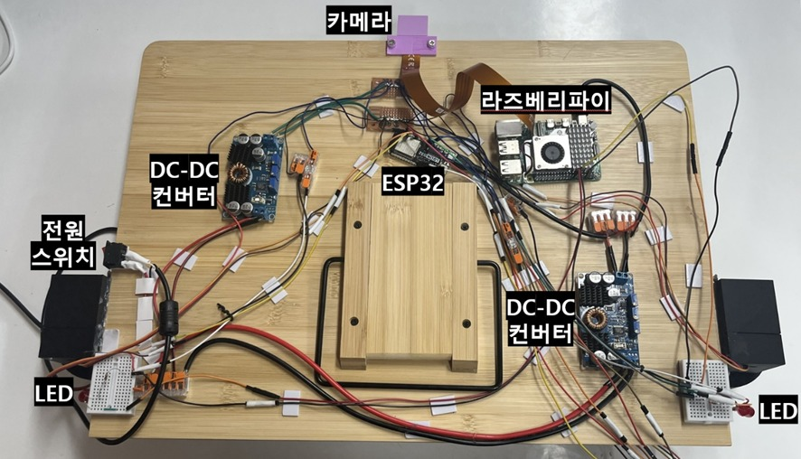
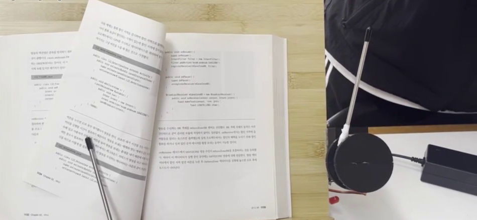

# 시선 추적 책장 넘김 장치
**Gaze-based Page Turner**

> 사용자의 시선만으로 종이책의 책장을 넘기고, 넘긴 페이지를 정리·고정하는 독서대 부착형 독서 보조기기

`2025 한이음 드림업` · `2025.03 – 2025.11` · `3인 팀`

왼쪽: 독서대 뒷면 하드웨어 구성 — 카메라 · Raspberry Pi · ESP32 · DC-DC 컨버터 · LED / 오른쪽: 시선 트리거 후 넘김 팔이 책장을 넘기는 모습

&nbsp;

**목차** · [개요](#1-개요) · [시스템 구성](#2-시스템-구성) · [한계 및 개선 방향](#3-한계-및-개선-방향) · [폴더 구조](#4-폴더-구조)

&nbsp;

## 1. 개요

신체적 제약으로 책장을 넘기기 어려운 사람을 위해, 손 대신 시선만으로 종이책을 넘길 수 있는 장치를 만들었습니다.  
기존 물리 독서 보조기구는 리모컨으로 조작하는 방식이라, 손을 쓰기 어려운 사용자는 여전히 사용할 수 없었습니다.  
팀 프로젝트명은 Eye Am Reader이며, 전시형 멘토님의 자문을 받아 진행했습니다.  
초기 시선 인식 실험은 팀원이 함께 진행했고, 이후 시스템을 두 파트로 나눠 개발했습니다.

결과보고서 → [`eye-am-reader-report.pdf`](docs/report/eye-am-reader-report.pdf)  
작동 영상 → [YouTube](https://www.youtube.com/watch?v=Gnrcc8VltUA)  
초기 시선 인식 실험 → [`archive/`](archive/)

[↑ 목차](#목차)

&nbsp;

## 2. 시스템 구성

| | ① 시선 인식·트리거 조윤서 | ② [책장 구동부](page-actuator/) **안유빈** (3D 모델링·서보모터 제어) 박경리 (모터 제어·전력 공급부) |
|---|---|---|
| **하드웨어** | Raspberry Pi 4 · NoIR 카메라 · LED | ESP32 · MG90S × 2 · MG946R × 4 · DC-DC 컨버터 |
| **입력** | 사용자 얼굴 영상 | Wi-Fi 소켓으로 받은 넘김 방향 명령 |
| **처리** | Face Mesh 랜드마크 → 동공 중심 → EMA · 칼만 필터 · 이상값 제거 | 책 너비 · 넘김 누적 횟수로 서보 각도 보정 |
| **판단·동작** | 트리거 영역에 일정 시간 머무르면 트리거 발생 | 고정 해제 → 책장 넘김 → 재고정 |
| **출력** | 넘김 방향 명령 · LED 상태 표시 | 책장 넘김 · 페이지 평탄화 |

② 책장 구동부의 데모·동작 원리·펌웨어·3D 모델·개발 과정은 [`page-actuator/`](page-actuator/)에서 볼 수 있습니다.

[↑ 목차](#목차)

&nbsp;

## 3. 한계 및 개선 방향

**한계**

- 넘김 · 고정 각도가 반복 테스트로 찾은 경험적 값이라 종이 재질 · 제본 상태에 따라 넘김 결과가 달라짐
- 페이지가 실제로 넘어갔는지 확인하는 단계 없이 정해진 순서대로만 동작
- 점퍼선 · 납땜 배선이 독서대 뒷면에 모여 있어 휴대성 · 내구성이 낮음

**개선 방향**

- 카메라로 넘김 성공 여부를 확인해 실패 시 다시 넘기는 **피드백 제어**
- 전용 PCB와 일체형 케이스로 배선 정리 및 소형화
- 장애인 · 고령자 대상 실사용 테스트로 사용성 검증

[↑ 목차](#목차)

&nbsp;

## 4. 폴더 구조

<pre>
gaze-page-turner/
├── <a href="page-actuator/">page-actuator/</a>                      ② 책장 구동부 (상세 README·펌웨어·3D 모델)
├── <a href="archive/">archive/</a>                            초기 시선 인식 실험 (팀 공동)
└── <a href="docs/">docs/</a>
    ├── <a href="docs/images/">images/</a>                         대표 결과 이미지
    └── <a href="docs/report/eye-am-reader-report.pdf">report/</a>                         결과보고서 (PDF)
</pre>

[↑ 목차](#목차)
