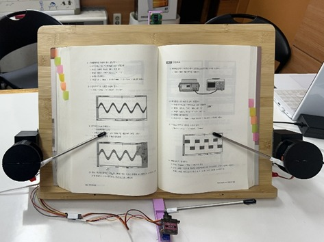
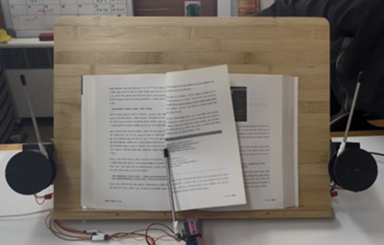

# 시선 추적 책장 넘김 장치
**Eye Am Reader**

사용자의 시선만으로 종이책의 책장을 넘기고, 넘긴 페이지를 자동으로 정리 · 고정하는 독서 보조기기

`2025 한이음 드림업` · `2025.03 – 11` · `3인 팀 + 멘토` · [`결과보고서 (PDF)`](docs/report/eye-am-reader-report.pdf) · [`작동 영상`](https://www.youtube.com/watch?v=Gnrcc8VltUA)

왼쪽: 책 고정 · 정리 장치가 양쪽 페이지를 눌러 평탄화 / 오른쪽: 시선 트리거 후 넘김 팔이 오른쪽 페이지를 넘기는 모습

## 개요

신체적 제약으로 책장을 넘기기 어려운 사람을 위해, **손 대신 시선만으로** 책장을 넘길 수 있는 장치를 만들었습니다.
기존 물리 독서 보조기구는 리모컨 방식이라 여전히 손 사용이 필요하다는 한계가 있었습니다.
시스템을 소프트웨어와 하드웨어 두 파트로 나눴습니다.

- ① **시선 인식 · 트리거 판정** — 사용자가 "어디를" 보고 있는가 (얼굴 랜드마크 · 동공 · 필터링)
- ② **[책장 넘김 · 고정 장치](page-turning-device/)** — 책장을 "어떻게" 넘기고 고정하는가 ← 내 담당 (3D 모델링 · 서보모터 제어)

## 시스템 구성

## ① 시선 인식 · 트리거 판정

**목표** — 실시간 영상에서 시선 좌표를 안정적으로 추적하고, 의도한 응시만 트리거로 판정

- **시선 추적** — MediaPipe Face Mesh로 얼굴 · 눈 랜드마크 검출, 눈 ROI에서 동공 중심 계산
- **좌표 안정화** — EMA · 칼만 필터로 노이즈 완화, Z-score 기반 이상값 제거, 양쪽 눈 좌표 평균
- **캘리브레이션** — LED 안내에 따라 책 좌 · 우 하단을 응시해 책 영역과 트리거 영역 자동 설정
- **트리거 판정** — 트리거 영역에 일정 프레임 이상 머무르면 발생, `MOVE_FREEZE_MS`로 연속 넘김 방지
- **얼굴 움직임 보정** — Procrustes 정렬로 고개 이동 · 거리 변화에 따른 좌표 왜곡 보정

## ② 책장 넘김 · 고정 장치 — 내 담당

**목표** — 트리거 신호에 맞춰 페이지를 넘기고, 넘긴 페이지가 되돌아오지 않도록 정리 · 고정

- **자동 책장 넘김** — MG90S 서보 기반 와이퍼 메커니즘으로 넘김 팔을 좌 · 우 대칭 구동
- **책 고정 · 정리** — MG946R 서보로 양쪽 정리 팔을 제어해 페이지를 눌러 평탄화, 동작 후 안전 위치 복귀
- **각도 보정** — 캘리브레이션의 책 너비로 하단 모터, 좌 · 우 넘김 누적 횟수로 상단 모터 각도 조절
- **3D 모델링** — 서보모터 케이스 · 넘김 팔 거치대 · 카메라 케이스 설계 및 프린팅

> 장치 구성 · 동작 시퀀스 · 각도 보정 · 개발 과정은 **[`page-turning-device/`](page-turning-device/)** 에서 볼 수 있습니다.

## 관찰 및 개선 방향

**한계**
- 넘김 · 고정 각도가 반복 테스트로 찾은 경험적 값이라 종이 재질 · 제본 상태에 따라 넘김 결과가 달라짐
- 페이지가 실제로 넘어갔는지 확인하는 단계 없이 정해진 시퀀스만 수행
- 점퍼선 · 납땜 배선이 독서대 뒷면에 집적되어 있어 휴대성 · 내구성이 낮음

**개선 방향**
- 카메라로 넘김 성공 여부를 확인해 실패 시 재시도하는 **피드백 제어**
- 전용 PCB와 일체형 케이스로 배선 정리 및 소형화
- 다양한 책 크기 · 두께에서 각도 데이터를 모아 보정식 정교화
- 장애인 · 고령자 대상 실사용 테스트로 사용성 검증

## 저장소 구조

<table>
<tbody>
<tr>
<td width="50%" valign="top" align="left">

📁 <a href="page-turning-device/"><b>page-turning-device</b></a> 
② 책장 넘김 · 고정 장치 — 상세 README · ESP32 코드 · 3D 모델

</td>
<td width="50%" valign="top" align="left">

📁 <a href="docs/"><b>docs</b></a> 
결과보고서 PDF · 대표 결과 이미지

</td>
</tr>
</tbody>
</table>

## 기술 스택

`Python` `C/C++` `Raspberry Pi` `ESP32` `PWM 서보 제어` `Wi-Fi 소켓 통신` `MediaPipe` `OpenCV` `Kalman Filter · EMA` `3D 모델링 · 프린팅`

## 팀 구성

<table>
<thead><tr><th>이름</th><th>역할</th></tr></thead>
<tbody><tr><td>조윤서 (팀장)</td><td>① MediaPipe 활용 Eye Tracking · 알고리즘 개발</td></tr></tbody>
<tbody><tr><td><b>안유빈</b></td><td><b><a href="page-turning-device/">② 3D 모델링 · 서보모터 제어</a></b></td></tr></tbody>
<tbody><tr><td>박경리</td><td>② 모터 제어 · 전력 공급부</td></tr></tbody>
<tbody><tr><td>전시형</td><td>멘토 — 프로젝트 수행 조언 · 전략 자문</td></tr></tbody>
</table>
