[← 프로젝트 메인](../README.md)

# ② 책장 구동부
**Page Actuator** · 시선 추적 책장 넘김 장치 중 담당 파트

> 시선 트리거 명령을 받아 서보모터로 책장을 넘기고, 넘긴 페이지가 되돌아오지 않도록 양쪽에서 눌러 고정하는 장치


<p>
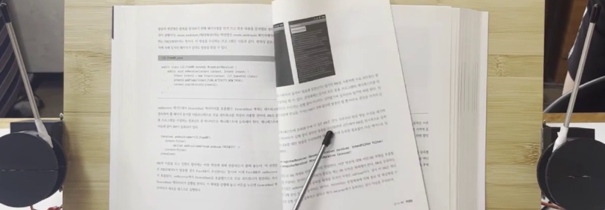
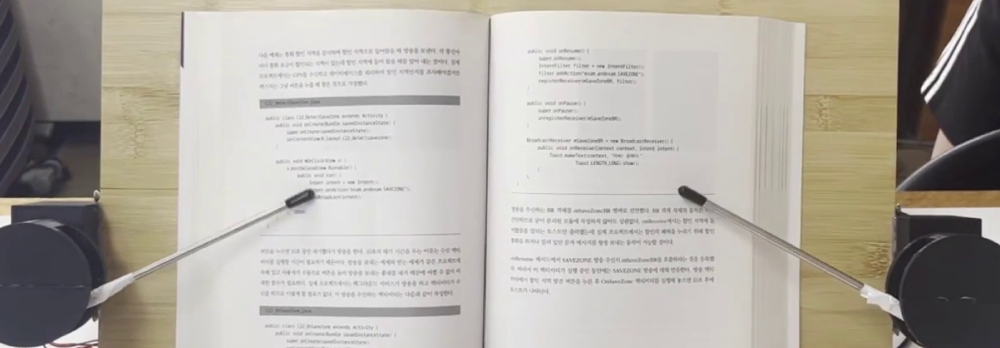
</p>
<sub>왼쪽: MG90S 넘김 팔이 오른쪽 페이지를 넘기는 모습 / 오른쪽: MG946R 고정 팔이 양쪽 페이지를 눌러 정리하는 모습</sub>

&nbsp;

<a id="목차"></a>**목차** · [개요](#1-개요) · [데모](#2-데모) · [동작 원리](#3-동작-원리) · [기구 설계](#4-기구-설계) · [트러블슈팅](#5-트러블슈팅) · [한계 및 개선 방향](#6-한계-및-개선-방향) · [실행 방법](#7-실행-방법) · [폴더 구조](#8-폴더-구조)

&nbsp;

## 1. 개요

한이음 드림업 프로젝트에서 초기 시선 인식 실험을 팀원과 함께 진행한 뒤, 파트를 나눠 ② 책장 구동부의 ESP32 펌웨어 · 서보모터 제어와 3D 모델링을 담당했습니다.  
시선 파트가 보낸 트리거 명령 하나를 고정 해제 → 넘김 → 재고정의 물리 동작으로 바꾸고, 책 크기와 두께에 맞춰 모터 각도를 보정합니다.

| | 기존 물리 독서 보조기구 | 이 장치 |
|---|---|---|
| **조작** | 리모컨 · 버튼 (손 사용 필요) | 시선 트리거 명령 (Wi-Fi) |
| **구조** | 크고 복잡해 휴대성이 낮음 | 기존 독서대에 붙이는 3D 프린팅 모듈 |
| **책 대응** | — | 책 너비 · 넘김 횟수로 모터 각도 보정 |

<sub>[↑ 목차](#목차)</sub>

&nbsp;

## 2. 데모

### 오른쪽 넘김

https://github.com/user-attachments/assets/5365bad5-5374-4ebf-a066-5d2267a26b24

<sub>고정 팔 해제 → 넘김 팔이 오른쪽 페이지를 넘김 → 고정 팔이 양쪽 페이지를 다시 눌러 정리</sub>

&nbsp;

### 왼쪽 넘김

https://github.com/user-attachments/assets/762839ab-9816-4a6e-b18e-23176ec6fc17

<sub>반대쪽 트리거도 같은 순서로 동작 — 넘김 팔 좌 · 우 대칭 구동</sub>

&nbsp;

### 다양한 크기의 책

https://github.com/user-attachments/assets/054ece03-62e3-4619-88f5-71064278f2d9

<sub>너비가 다른 두 책에서 같은 장치로 넘김 · 고정</sub>

&nbsp;

### 두께 보정

https://github.com/user-attachments/assets/83e51d89-f6bd-4b01-a9d0-90b885913aee

<sub>오른쪽으로 연속 8회 넘기며 기록한 시리얼 로그 — 넘김 3회마다 상단 모터 목표 각도가 0.3°씩 바뀜 (서보 단독 테스트, 3배속)</sub>

&nbsp;

### 결과 요약

| 기능 | 결과 |
|---|---|
| 자동 책장 넘김 | 좌 · 우 트리거 모두 넘김 팔이 한 장씩 넘긴 뒤 안전 위치로 복귀 |
| 책 고정 · 정리 | 넘김 전 고정 해제, 넘김 후 양쪽 페이지를 눌러 평탄화 · 되말림 방지 |
| 책 너비 보정 | 너비가 다른 책에서 고정 팔 하단 모터 각도를 바꿔 같은 동작 수행 |
| 두께 보정 | 넘김 횟수 차이 3회마다 상단 모터 목표 각도 0.3° 조정 (왼쪽 15.0° → 15.3° → 15.6°) |

<sub>[↑ 목차](#목차)</sub>

&nbsp;

## 3. 동작 원리

### 처리 흐름

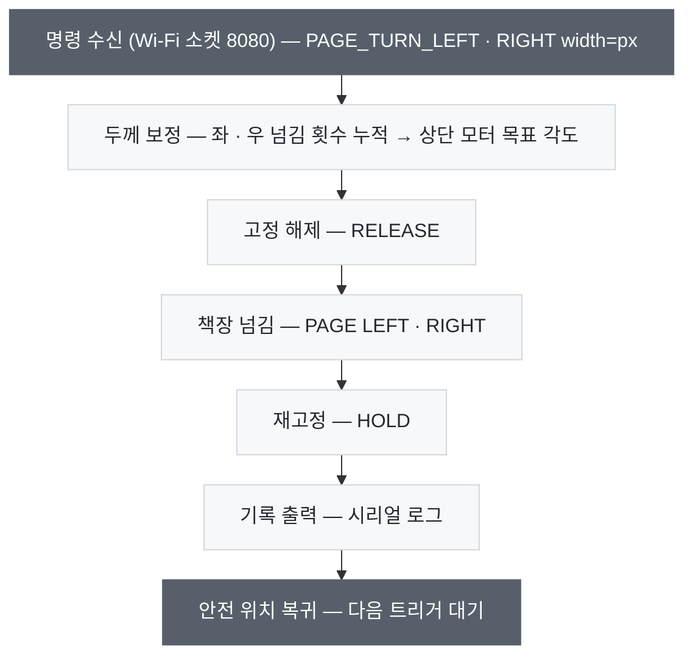

넘기기 전에 고정을 먼저 풀어, 고정 팔이 넘어가는 페이지를 붙잡지 않도록 순서를 정했습니다.  
동작 중에 들어온 명령은 처리하지 않도록 `isMoving` 상태로 막았습니다.

<details>
<summary><b>하드웨어 구성</b></summary>
<br>

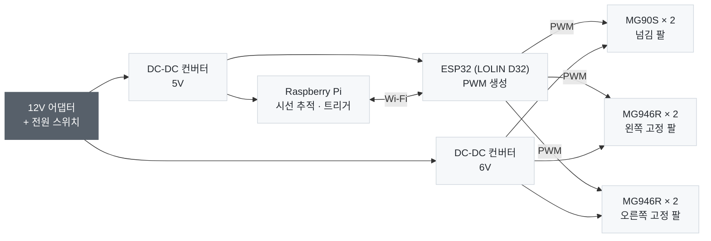

| 부품 | 역할 |
|---|---|
| MG90S × 2 | 토크가 작은 소형 서보 — 넘김 팔을 와이퍼처럼 움직여 페이지를 넘김 |
| MG946R × 4 | 토크가 큰 서보 — 좌 · 우 고정 팔을 상단 · 하단 2축으로 움직여 페이지를 누름 |
| DC-DC 컨버터 | 12V를 Raspberry Pi · ESP32용 5V와 서보용 6V로 나눠 공급 |

<p>
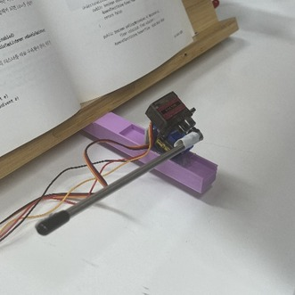
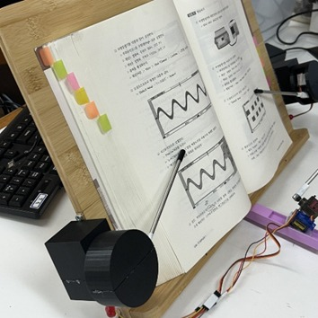
</p>
<sub>왼쪽: MG90S 넘김 팔과 3D 프린팅 거치대 / 오른쪽: MG946R 고정 팔</sub>

</details>

&nbsp;

### 각도 보정 규칙

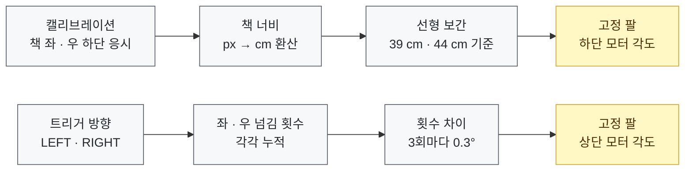

책 너비에 따라 고정 팔이 내려오는 각도를 정하고, 한쪽으로 넘길수록 두꺼워지는 쪽과 얇아지는 쪽에 맞춰 누르는 각도를 조금씩 바꿉니다.

<details>
<summary><b>보정식 · 시리얼 로그</b></summary>
<br>

| 항목 | 식 · 값 |
|---|---|
| px → cm | `cm = 39 + (px − 27) × 5 / 9` |
| 하단 모터 (L1 · R1) | 책 너비 39 cm ~ 44 cm 사이 선형 보간 — 왼쪽 60° → 90°, 오른쪽 120° → 90° |
| 상단 모터 (L2 · R2) | (넘긴 쪽 횟수 − 반대쪽 횟수) ÷ 3의 정수 부분 × 0.3°만큼 기준값에서 조정 |
| 상단 모터 기준값 | 통합본 [`servo_final.ino`](firmware/servo_final/servo_final.ino) 8° · 168° / 데모 로그의 서보 단독 테스트본 15° · 165° |

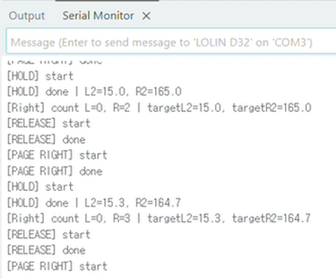

| 오른쪽 넘김 횟수 | 왼쪽 상단 모터 (`targetL2`) | 오른쪽 상단 모터 (`targetR2`) |
|:-:|:-:|:-:|
| 1 ~ 2회 | 15.0° | 165.0° |
| 3 ~ 5회 | 15.3° | 164.7° |
| 6 ~ 8회 | 15.6° | 164.4° |

오른쪽으로 넘길수록 왼쪽 페이지는 두꺼워지고 오른쪽 페이지는 얇아져, 두 상단 모터의 목표 각도가 반대 방향으로 바뀝니다.

</details>

<sub>[↑ 목차](#목차)</sub>

&nbsp;

## 4. 기구 설계

- 서보모터 · 카메라 장착용 거치대를 Tinkercad로 설계하고 3D 프린팅
- 프린팅 후 실제 독서대에 부착해 각도 · 위치를 맞추며 반복 수정
- 넘김 팔 끝에는 고무 마개를 씌워 종이와의 마찰 확보
- 서보 케이스 · 카메라 케이스 모델 → [`models/`](models/) (GitHub에서 STL 파일을 열면 3D로 볼 수 있습니다)

### 고정 팔 서보 케이스

<p>
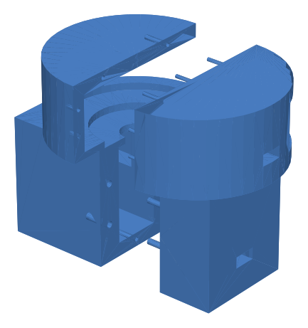
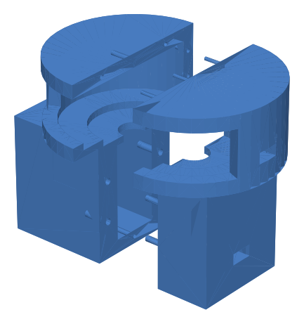
</p>
<sub>왼쪽 · 오른쪽 고정 팔 서보 케이스 — MG946R 상단 · 하단 2축을 한 케이스에 결합 (Tinkercad)</sub>

&nbsp;

### 넘김 팔 거치대

<p>
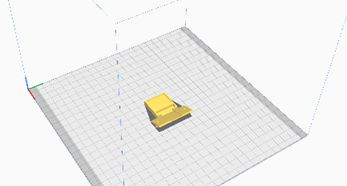
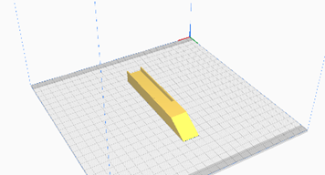
</p>
<sub>독서대 하단에 부착해 MG90S와 쇠 막대를 고정하는 부품</sub>

<sub>[↑ 목차](#목차)</sub>

&nbsp;

## 5. 트러블슈팅

| # | 문제 | 해결 |
|:-:|---|---|
| 1 | 책이 끝까지 넘어가지 않거나 고정이 풀림 | 서보 부착 방향 · 각도를 반복 테스트로 조정, 넘김 팔 좌 · 우 대칭 동작 |
| 2 | 넘길수록 고정이 불안정해짐 | 좌 · 우 넘김 횟수를 누적해 상단 모터 각도 보정 |
| 3 | 독서대 뒷면 배선 간섭 · 단선 | 부품 배치와 선 경로를 다시 설계, 납땜 연결부 보강 |

<details>
<summary><b>원인 자세히 보기</b></summary>
<br>

| # | 원인 |
|:-:|---|
| 1 | 각도가 너무 크거나 작으면 페이지를 끝까지 넘기지 못하거나 누르는 힘이 부족함 |
| 2 | 한쪽으로 넘길수록 좌 · 우 페이지 두께가 달라져 같은 각도로는 누르는 위치가 달라짐 |
| 3 | 점퍼선으로 부품을 연결하면서 독서대 뒷면에 장치가 모여 선끼리 간섭 |

펌웨어 개발 단계는 [`archive/README.md`](archive/README.md) 참고

</details>

<sub>[↑ 목차](#목차)</sub>

&nbsp;

## 6. 한계 및 개선 방향

**한계**

- 각도가 경험적 값이라 종이 재질 · 제본 방식이 다른 책에서는 재조정이 필요함
- 책 너비 보정이 두 기준 책 사이의 선형 보간이라, 그 범위를 벗어난 크기의 책에서는 오차가 생김
- 페이지가 실제로 넘어갔는지 확인하지 않고 정해진 순서대로만 동작

**개선 방향**

- 카메라로 넘김 성공 여부를 확인해 실패 시 다시 넘기는 피드백 제어
- 시작 시 책 두께와 페이지 수로 한 장당 두께를 계산해 고정 각도 자동 설정
- 좌 · 우 거리 센서로 양쪽 페이지 높이를 직접 측정해 넘길 때마다 보정
- 전용 PCB · 일체형 케이스로 배선 정리 및 휴대성 개선

<sub>[↑ 목차](#목차)</sub>

&nbsp;

## 7. 실행 방법

1. Arduino IDE에 ESP32 보드 패키지와 `ESP32Servo` 라이브러리 설치
2. [`firmware/servo_final/servo_final.ino`](firmware/servo_final/servo_final.ino)를 열고 `YOUR_SSID` · `YOUR_PASSWORD`를 라즈베리파이와 같은 Wi-Fi로 수정
3. 보드를 **LOLIN D32**로 선택해 업로드한 뒤, 시리얼 모니터(115200 baud)에서 ESP32 IP 확인
4. 같은 네트워크에서 8080 포트로 명령 전송

```bash
echo "PAGE_TURN_RIGHT width=30" | nc <ESP32_IP> 8080   # 책 너비 30px로 오른쪽 넘김
```

<details>
<summary><b>명령 · 핀 배치</b></summary>
<br>

| 명령 | 응답 | 동작 |
|---|---|---|
| `PAGE_TURN_LEFT width=<px>` · `PAGE_TURN_RIGHT width=<px>` | `LEFT_ACTION_ACCEPTED` · `RIGHT_ACTION_ACCEPTED` | 책 너비 갱신 후 해당 방향으로 넘김 |
| `LEFT` · `RIGHT` | 위와 같음 | 마지막 책 너비로 넘김 |
| `RESET` | `RESET_ACCEPTED` | 모든 서보 초기 위치 |

| 서보 | 핀 |
|---|---|
| 왼쪽 고정 팔 하단 · 상단 (MG946R) | 16 · 17 |
| 오른쪽 고정 팔 하단 · 상단 (MG946R) | 21 · 22 |
| 넘김 팔 1 · 2 (MG90S) | 25 · 23 |

</details>

<sub>[↑ 목차](#목차)</sub>

&nbsp;

## 8. 폴더 구조

<pre>
page-actuator/
├── <a href="README.md">README.md</a>
├── <a href="firmware/servo_final/">firmware/servo_final/</a>
│   └── <a href="firmware/servo_final/servo_final.ino">servo_final.ino</a>                   ESP32 최종 펌웨어
├── <a href="models/">models/</a>
│   ├── <a href="models/servo_case_left.stl">servo_case_left.stl</a>               왼쪽 고정 팔 서보 케이스
│   ├── <a href="models/servo_case_right.stl">servo_case_right.stl</a>              오른쪽 고정 팔 서보 케이스
│   ├── <a href="models/servo_case_pair.stl">servo_case_pair.stl</a>               왼쪽 + 오른쪽 출력용 합본
│   └── <a href="models/camera_case.stl">camera_case.stl</a>                   카메라 케이스
├── <a href="archive/">archive/</a>                              테스트 펌웨어 · 이전 모델
└── <a href="docs/images/">docs/images/</a>                          README 이미지
</pre>

<sub>[↑ 목차](#목차)</sub>
