[← 프로젝트 메인](../README.md)

# ② 책장 넘김 · 고정 장치

**Page Turning Device** · Eye Am Reader 프로젝트 중 내 담당 파트

시선 트리거 신호를 받아 서보모터로 책장을 넘기고,
넘긴 페이지가 되돌아오지 않도록 양쪽 정리 팔로 눌러 고정하는 하드웨어 장치

작동 영상 — 시선 트리거 → 고정 해제 → 책장 넘김 → 재고정 (클릭 시 YouTube)

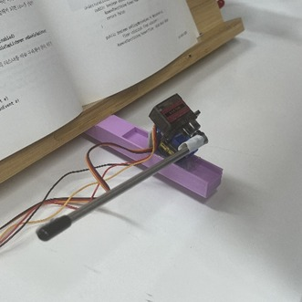
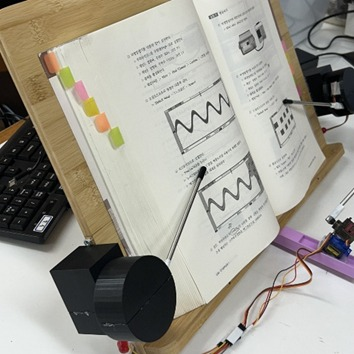

왼쪽: MG90S 넘김 팔과 3D 프린팅 거치대 / 오른쪽: MG946R 정리 팔이 페이지를 눌러 고정하는 모습

---

## 개요

2025 한이음 드림업에서 진행한 시선 추적형 자동 책장 넘김 장치 프로젝트입니다.
시스템을 두 파트로 나눠 진행했습니다.

- ① 시선 인식 · 트리거 판정
- ② **책장 넘김 · 고정 장치** ← 내 담당 (3D 모델링 · 서보모터 제어)

시선 추적이 아무리 정확해도, 책장이 **한 장씩 · 되돌아오지 않게** 넘어가지 않으면 독서가 이어지지 않습니다.
이 파트는 트리거 신호 하나를 **고정 해제 → 넘김 → 재고정**의 물리 동작으로 바꾸고, 책 크기와 두께 변화에 맞춰 각도를 보정합니다.

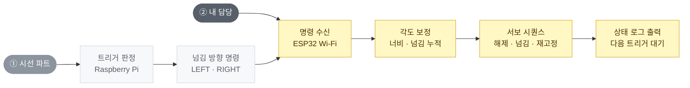

---

## 저장소 구조

📁 <b>page-turning-device</b> &nbsp;·&nbsp; <code>README.md</code>

<table>
<tbody>
<tr>
<td width="33%" valign="top" align="left">

📁 <a href="firmware/"><b>firmware</b></a> 
ESP32 서보 제어 코드 (Arduino)

</td>
<td width="33%" valign="top" align="left">

📁 <a href="models/"><b>models</b></a> 
서보 케이스 · 넘김 팔 거치대 3D 모델

</td>
<td width="33%" valign="top" align="left">

📁 <a href="docs/"><b>docs</b></a> 
실물 사진 · 3D 모델 렌더 · 시리얼 로그

<code>images/</code>

</td>
</tr>
</tbody>
</table>

---

## 하드웨어 구성

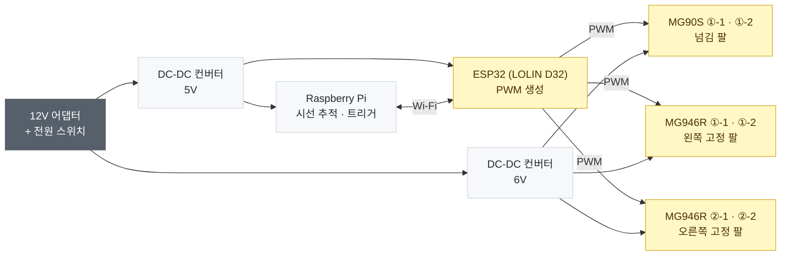

- **넘김 팔 (MG90S × 2)** — 가볍고 빠른 소형 서보로 와이퍼처럼 페이지를 쓸어 넘김
- **고정 팔 (MG946R × 4)** — 토크가 큰 서보로 좌 · 우 페이지를 눌러 평탄화, 각 팔은 상단 · 하단 2축
- **전원 분리** — 서보 구동 전류가 제어 보드에 영향을 주지 않도록 서보 6V · 보드 5V 라인을 분리

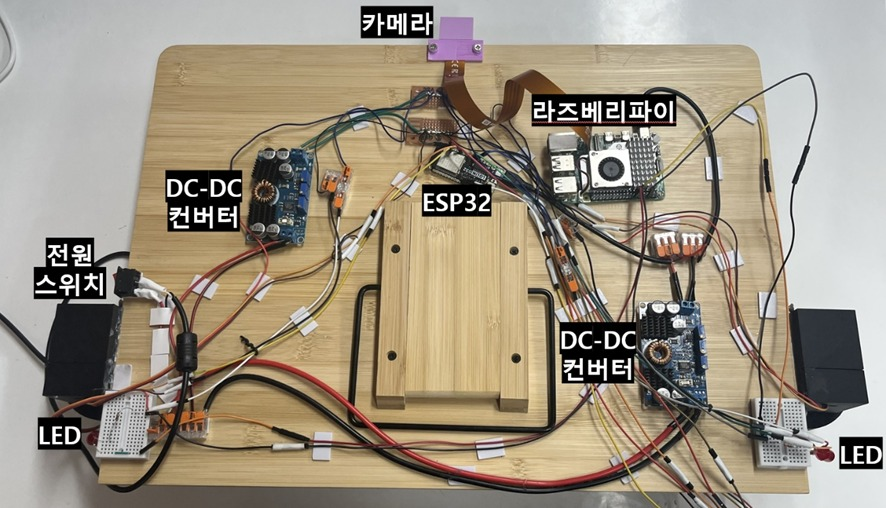

독서대 뒷면 전체 구성 — 카메라 · Raspberry Pi · ESP32 · DC-DC 컨버터 2개 · 전원 스위치 · LED

---

## 동작 시퀀스

- 넘기기 전에 **반드시 고정을 먼저 해제**해, 정리 팔이 넘어가는 페이지를 붙잡지 않도록 순서를 고정
- 넘김이 끝나면 바로 재고정해 페이지 되말림 방지, 이후 안전 위치에서 다음 트리거 대기
- 한 번의 응시로 여러 장이 넘어가지 않도록 동작 후 일정 시간 추가 트리거 차단

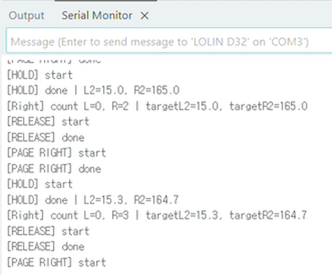
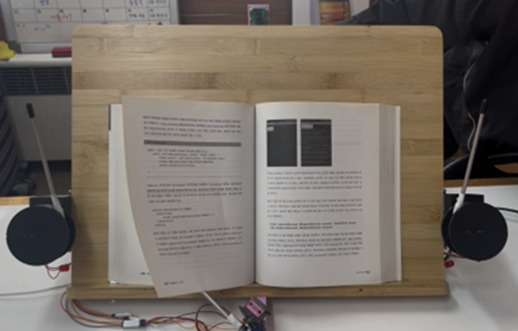

왼쪽: ESP32 시리얼 로그 — HOLD · RELEASE · PAGE RIGHT 순서와 누적 횟수에 따른 목표 각도 / 오른쪽: 실제 넘김 동작

---

## 각도 보정 규칙

**① 책 너비 → 고정 팔 하단 모터**
- 캘리브레이션에서 응시한 책 좌 · 우 하단 지점으로 책 너비(px)를 얻음
- 미리 측정한 **두 가지 책 너비 예시값**을 기준으로 선형 보간해 하단 모터 각도로 환산
- 책이 넓을수록 정리 팔이 더 바깥쪽을 누르도록 조절

**② 넘김 누적 횟수 → 고정 팔 상단 모터**
- 오른쪽으로 넘길수록 왼쪽 페이지가 두꺼워지고 오른쪽은 얇아짐
- 좌 · 우 넘김 횟수를 각각 누적해 상단 모터 목표 각도를 미세 조정
  - 시리얼 로그 예: 오른쪽 2회 → `R2=165.0`, 3회 → `R2=164.7` / `L2=15.0` → `15.3`

---

## 3D 모델링

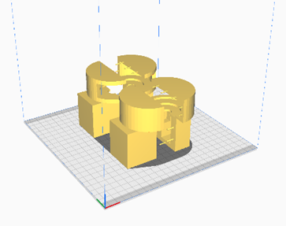
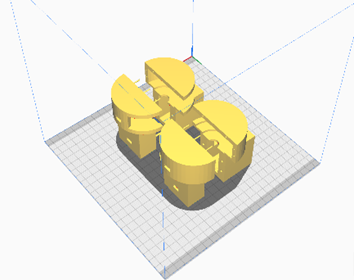

고정 팔 서보 케이스 — 상단 · 하단 MG946R 2축을 한 케이스에 결합

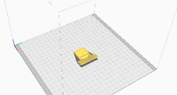
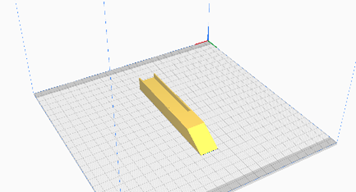

넘김 팔 거치대 부품 — 독서대 하단에 부착해 MG90S와 쇠 막대를 고정

- 서보모터 · 카메라 장착용 거치대를 직접 설계하고 3D 프린팅
- 프린팅 후 실제 독서대에 부착해 **각도 · 위치를 맞추며 반복 수정**
- 넘김 팔 끝에는 고무 마개를 씌워 종이와의 마찰 확보

---

## 개발 과정에서 해결한 문제

**① 각도가 맞지 않으면 책이 안 넘어가거나 고정이 풀림**
- 원인: 넘김 · 고정 각도가 너무 크면 여러 장이 걸리고, 작으면 페이지를 끝까지 넘기지 못함
- 해결: 서보 부착 방향과 각도를 반복 테스트로 조정, 좌 · 우 대칭 동작이 되도록 넘김 팔 각도 재설계

**② 책 두께가 넘길수록 바뀌어 고정이 불안정**
- 원인: 한쪽으로 넘길수록 좌 · 우 페이지 두께가 달라져 같은 각도로는 누르는 힘이 달라짐
- 해결: 좌 · 우 넘김 횟수를 누적해 상단 모터 각도를 보정

**③ 영상 처리 중 하드웨어 제어로 메인 루프 지연**
- 원인: 시선 검출과 서보 · LED 제어가 같은 흐름에서 실행되어 프레임 속도 저하
- 해결: 하드웨어 제어를 별도 스레드로 분리해 영상 처리와 병렬 실행

**④ 독서대 뒷면 배선 정리**
- 원인: 점퍼선으로 부품을 연결하면서 독서대 뒷면에 장치가 집적되어 간섭 발생
- 해결: 부품 배치와 선 경로를 다시 설계하고, 납땜 연결부를 보강해 단선 방지

---

## 한계와 확장 방향

**한계**
- 각도가 경험적 값이라 종이 재질 · 제본 방식이 다른 책에서는 재조정 필요
- 책 너비 환산이 두 예시값 기준 선형 보간이라 그 범위를 벗어난 크기의 책에서는 오차 발생
- 페이지가 실제로 넘어갔는지 확인하지 않고 정해진 시퀀스만 수행

**확장 방향**
- 카메라로 넘김 성공 여부를 확인해 실패 시 재시도하는 피드백 제어
- 전용 PCB · 일체형 케이스로 배선 정리 및 휴대성 개선
- 다양한 책에서 각도 데이터를 모아 보정식 정교화
